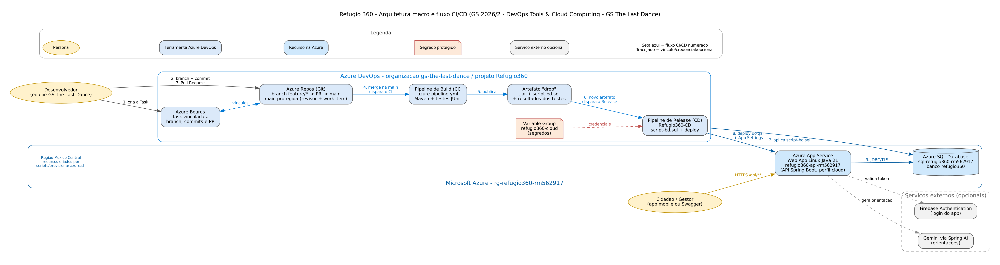

# Refúgio 360 — API na nuvem com Azure DevOps

**Global Solution 2026/2 · CitizenTech · DevOps Tools & Cloud Computing · Grupo GS The Last Dance**

API REST do **Refúgio 360**, solução CitizenTech para apoiar comunidades durante ondas de calor,
enchentes e falta de energia. Nesta entrega, a API Java é publicada na **Azure** com banco
**Azure SQL Database**, e todo o ciclo de vida usa o **Azure DevOps**: **Azure Boards**, **Azure Repos**
e **Azure Pipelines** (Build + Release). A infraestrutura é criada por **scripts Azure CLI**.

| | |
|---|---|
| **Organização Azure DevOps** | https://dev.azure.com/gs-the-last-dance |
| **Projeto (privado, Git)** | https://dev.azure.com/gs-the-last-dance/Refugio360 |
| **Azure Repos** | https://dev.azure.com/gs-the-last-dance/Refugio360/_git/Refugio360 |
| **API publicada (Swagger)** | https://refugio360-api-rm562917.azurewebsites.net/swagger-ui/index.html |
| **Vídeo de demonstração** | _adicionar o link do YouTube_ |
| **Repositório da API Java (origem)** | https://github.com/Last-Global-Solution/java-refugio360 |

## Integrantes — GS The Last Dance

| Nome completo | RM | Turma |
|---|---|---|
| Gabriely Bonfim Silva | RM566242 | 2TDSA |
| Mirelly Sousa Alves | RM566299 | 2TDSA |
| Ruan Luca Feliciano de Carvalho | RM562218 | 2TDSA |
| Murilo Macedo Silva | RM566462 | 2TDSA |
| Henrique Rodrigues Vespasiano | RM562917 | 2TDSPW |

---

## 1. Solução proposta

O cidadão encontra **locais seguros** (abrigos, UBS, pontos de água), consulta **pontos de risco**
e registra **ocorrências** (alagamento, falta de energia, calor extremo). O gestor público mantém
os locais e as áreas de risco e acompanha as ocorrências, que seguem o ciclo
`PENDENTE → EM_ANALISE → RESOLVIDA`. Para cada ocorrência, a API gera uma **orientação**
personalizada para o perfil do cidadão (idoso, PCD, família), considerando os locais seguros mais próximos.

**Por que na nuvem com CI/CD:** a API precisa estar disponível justamente nos momentos de crise.
Com o Azure Web App e o Azure SQL, ela fica acessível pela internet com HTTPS e banco gerenciado.
Com as pipelines, cada mudança aprovada por Pull Request é compilada, testada e publicada
automaticamente, sem deploy manual.

**Stack:** Java 21 · Spring Boot 3.4 · Spring Security (JWT local + Firebase) · Spring Data JPA ·
Hibernate · Bean Validation · springdoc-openapi (Swagger) · Spring AI (Gemini, opcional) ·
RabbitMQ (opcional) · Maven · JUnit 5 · Azure SQL Database · Azure App Service · Azure CLI ·
Azure DevOps (Boards, Repos, Pipelines).

---

## 2. Desenho macro da arquitetura



**Fluxo, na ordem da numeração:**

1. O desenvolvedor cria uma **Task** no Azure Boards.
2. Cria uma **branch** a partir da Task e faz os **commits** no Azure Repos.
3. Abre um **Pull Request** para a `main`. A política exige revisor e work item vinculado.
4. O **merge do PR na `main`** dispara automaticamente a **pipeline de Build (CI)**.
5. O CI compila, roda os **testes JUnit**, publica os resultados e o **artefato `drop`** (`.jar` + `script-bd.sql`).
6. O **novo artefato** dispara automaticamente a **pipeline de Release (CD)**.
7. A Release aplica o **`script-bd.sql`** no **Azure SQL Database**.
8. A Release faz o **deploy do `.jar`** no **Azure Web App**, aplicando as configurações a partir de variáveis protegidas.
9. A API conecta no Azure SQL via JDBC com TLS. O cidadão ou gestor usa a API por HTTPS.

**Legenda do desenho:**

| Elemento | Significado |
|---|---|
| Elipse amarela | Persona: desenvolvedor, cidadão ou gestor |
| Caixa azul-clara | Ferramenta do Azure DevOps (Boards, Repos, Pipelines) |
| Caixa azul | Recurso na Azure (Web App, Azure SQL) |
| Nota vermelha | Segredo protegido (Variable Group) |
| Caixa cinza tracejada | Serviço externo opcional (Firebase, Gemini) |
| Seta azul numerada | Fluxo de CI/CD |
| Linha tracejada | Vínculo, credencial ou integração opcional |

| Componente | Recurso | Função |
|---|---|---|
| Azure Boards | Task (work item) | Planejamento e rastreabilidade: vínculo com branch, commits e PR |
| Azure Repos | Repositório Git `Refugio360` | Código-fonte; `main` protegida por políticas |
| Azure Pipelines (Build) | `azure-pipeline.yml` | CI: build Maven, testes JUnit e artefato |
| Azure Pipelines (Release) | `Refugio360-CD` | CD: `script-bd.sql` no Azure SQL e deploy no Web App |
| Variable Group | `refugio360-cloud` | URL, usuário e senha do banco; JWT e gestor inicial (secrets) |
| Service Connection | `sc-refugio360-azure` | Acesso da Release à Azure (Workload Identity, escopo do Resource Group) |
| Resource Group | `rg-refugio360-rm562917` | Agrupa os recursos (Mexico Central) |
| Azure SQL Database | `sql-refugio360-rm562917` / `refugio360` | Banco relacional PaaS (Basic) |
| App Service Plan | `plan-refugio360-rm562917` | Plano Linux B1 |
| Web App | `refugio360-api-rm562917` | API Java 21, perfil `cloud` |

---

## 3. Estrutura do repositório

```
azure-pipeline.yml               pipeline de Build (CI) em YAML, na raiz
scripts/
  provisionar-azure.sh           cria toda a infraestrutura via Azure CLI
  limpar-azure.sh                remove os recursos (após a avaliação)
  script-bd.sql                  DDL do banco (Azure SQL), executado pela Release
dockerfiles/
  Dockerfile                     imagem da API (opcional; o deploy oficial é no Web App)
  docker-compose.yml             RabbitMQ para desenvolvimento local
docs/arquitetura-macro.png       desenho macro da arquitetura
src/main/java/...                código da API (controller, service, repository, model...)
src/main/resources/
  application.properties         perfil local (H2)
  application-cloud.properties   perfil de nuvem (Azure SQL; tudo por variável de ambiente)
src/test/java/...                testes JUnit executados no CI
```

---

## 4. Infraestrutura na Azure (Azure CLI)

Toda a infraestrutura é criada pelo script [`scripts/provisionar-azure.sh`](scripts/provisionar-azure.sh),
no Azure Cloud Shell (Bash) ou em uma máquina com `az login`:

```bash
export SQL_ADMIN_PASSWORD='<senha-forte>'     # nunca versionar
bash scripts/provisionar-azure.sh
```

Ordem de criação:

1. Resource Group `rg-refugio360-rm562917`, na região `mexicocentral`.
2. Azure SQL Server `sql-refugio360-rm562917`, com TLS 1.2 e firewall liberado para os serviços do Azure e para o IP de quem roda o script.
3. Azure SQL Database `refugio360` (Basic, 2 GB).
4. App Service Plan Linux B1 `plan-refugio360-rm562917`.
5. Web App Java 21 `refugio360-api-rm562917`, com HTTPS obrigatório, Always On e perfil `cloud`.

O script não grava senhas no Web App: os segredos são aplicados pela pipeline de Release.
Para remover tudo depois da avaliação, rode `bash scripts/limpar-azure.sh`.

A assinatura Azure for Students só libera as regiões `mexicocentral`, `chilecentral`,
`eastus`, `southcentralus` e `northcentralus`. Para trocar, use `LOCATION=<região> bash scripts/provisionar-azure.sh`.

---

## 5. Banco de dados — Azure SQL Database

O DDL está em [`scripts/script-bd.sql`](scripts/script-bd.sql):

- **gerado a partir das entidades JPA da API**, no dialeto do SQL Server;
- **comentado**, explicando cada tabela;
- **idempotente**: cada objeto só é criado se ainda não existir.

A Release executa o script a cada deploy. Na nuvem, o Hibernate roda com
`ddl-auto=validate`: ele só confere se o banco bate com as entidades e impede a API de subir se houver divergência.

| Tabela | Conteúdo | CRUD na API |
|---|---|---|
| `tb_local_seguro` | abrigos, UBS, pontos de água | **sim** (`/api/locais-seguros`) |
| `tb_ponto_risco` | áreas de risco | **sim** (`/api/pontos-risco`) |
| `tb_ocorrencia` | relatos dos cidadãos (FK `tb_usuario`) | **sim** (`/api/ocorrencias`) |
| `tb_usuario` | cidadãos e gestores | cadastro e login |
| `tb_orientacao` | orientação de cada ocorrência (FK `tb_ocorrencia`) | gerada pela API |
| `tb_orientacao_local` | N:N orientação × locais seguros | gerada pela API |

---

## 6. Azure DevOps — Boards, Repos e políticas

- **Projeto:** `Refugio360`, **privado**, versionamento **Git**, processo **Scrum**.
- **Acesso do professor:** Basic na organização e **Project Administrators** no projeto.
- **Integrantes:** Contributors.
- **Boards ↔ Repos:** cada Task é vinculada à **branch**, aos **commits** e ao **Pull Request**. Nos commits, a mensagem cita `#<id da Task>`.
- **Políticas da branch `main`** (Repos → Branches → main → Branch policies):

  | Política | Configuração |
  |---|---|
  | Require a minimum number of reviewers | 1 revisor; o autor pode aprovar o próprio PR (simulação permitida pelo enunciado) |
  | Check for linked work items | **obrigatório** |
  | Automatically included reviewers | **Henrique Rodrigues Vespasiano (RM562917)** como revisor padrão obrigatório |

  Com essas políticas não há push direto na `main`. Toda mudança entra por Pull Request, e o
  **Build só roda depois do merge na `main`** (o CI não tem gatilho de PR: `pr: none`).

---

## 7. Azure Pipelines

### 7.1 Build (CI) — [`azure-pipeline.yml`](azure-pipeline.yml)

Dispara **automaticamente a cada commit na `main`**, ou seja, a cada merge de PR.

| Etapa (task) | O que faz |
|---|---|
| `Maven@4` | `mvn clean package`: compila e executa os **testes JUnit**; publica os resultados na aba **Tests** |
| `CopyFiles@2` | Copia o `.jar` da API para o pacote |
| `CopyFiles@2` | Copia o `scripts/script-bd.sql` para o pacote |
| `PublishBuildArtifacts@1` | Publica o artefato **`drop`** (`app/*.jar` + `sql/script-bd.sql`) |

Os testes ficam em `src/test/java`: carga do contexto Spring, ciclo de status da ocorrência e
validação dos dados de locais seguros e pontos de risco.

### 7.2 Release (CD) — `Refugio360-CD`

Pipeline de Release com **gatilho de implantação contínua**: roda **automaticamente quando o CI
publica um novo artefato** da `main`. Stage **Produção**:

| Etapa (task) | O que faz |
|---|---|
| Azure SQL Database deployment | Executa `sql/script-bd.sql` no Azure SQL (`refugio360`) |
| Azure App Service deploy | Publica o `.jar` no Web App Linux Java 21 e aplica as App Settings |

### 7.3 Variáveis de ambiente das pipelines

| Variável | Onde | Protegida |
|---|---|---|
| `javaHome`, `mavenOpts`, `artifactName`, `jarName` | `azure-pipeline.yml` | não (sem dados sensíveis) |
| `DATABASE_URL` | Variable Group `refugio360-cloud` | não |
| `DATABASE_USERNAME`, `DATABASE_PASSWORD` | Variable Group `refugio360-cloud` | **secret** |
| `JWT_SECRET` | Variable Group `refugio360-cloud` | **secret** |
| `GESTOR_EMAIL` | Variable Group `refugio360-cloud` | não |
| `GESTOR_PASSWORD` | Variable Group `refugio360-cloud` | **secret** |

Nenhuma senha está no código: o perfil `cloud` (`application-cloud.properties`) só lê variáveis de ambiente.

---

## 8. CRUD — JSON de cada tabela

Base: `https://refugio360-api-rm562917.azurewebsites.net`.
O Swagger está em `/swagger-ui/index.html`.

**Autenticação (gestor):** as rotas de escrita de locais seguros e pontos de risco exigem o
perfil `GESTOR`. O e-mail do gestor é `gestor@refugio360.com`; a senha fica na variável secreta
`GESTOR_PASSWORD`.

```http
POST /api/auth/login
Content-Type: application/json

{ "email": "gestor@refugio360.com", "senha": "<GESTOR_PASSWORD>" }
```

A resposta traz `accessToken`; envie-o como `Authorization: Bearer <accessToken>`.
No Swagger, use o botão **Authorize**.

### 8.1 `tb_local_seguro` — `/api/locais-seguros`

**Create** — `POST /api/locais-seguros` → `201`
```json
{
  "nome": "Abrigo Central",
  "tipo": "ABRIGO",
  "endereco": "Rua A, 100",
  "latitude": -23.55,
  "longitude": -46.63,
  "descricao": "Entrada acessivel"
}
```

**Read** — `GET /api/locais-seguros/{id}` → `200` (lista: `GET /api/locais-seguros?page=0&size=10`)

**Update** — `PUT /api/locais-seguros/{id}` → `200`
```json
{
  "nome": "Abrigo Central Atualizado",
  "tipo": "ABRIGO",
  "endereco": "Rua A, 100",
  "latitude": -23.55,
  "longitude": -46.63,
  "descricao": "Capacidade 200 pessoas"
}
```

**Delete** — `DELETE /api/locais-seguros/{id}` → `204`

**Conferência no banco:**
```sql
SELECT id, nome, tipo, endereco, descricao FROM dbo.tb_local_seguro ORDER BY id DESC;
```

### 8.2 `tb_ponto_risco` — `/api/pontos-risco`

**Create** — `POST /api/pontos-risco` → `201`
```json
{
  "titulo": "Area sujeita a alagamento",
  "nivelPerigo": "ALTO",
  "latitude": -23.56,
  "longitude": -46.64
}
```

**Read** — `GET /api/pontos-risco/{id}` → `200`

**Update** — `PUT /api/pontos-risco/{id}` → `200`
```json
{
  "titulo": "Area sujeita a alagamento severo",
  "nivelPerigo": "CRITICO",
  "latitude": -23.56,
  "longitude": -46.64
}
```

**Delete** — `DELETE /api/pontos-risco/{id}` → `204`

**Conferência no banco:**
```sql
SELECT id, titulo, nivel_perigo, latitude, longitude FROM dbo.tb_ponto_risco ORDER BY id DESC;
```

### 8.3 `tb_ocorrencia` — `/api/ocorrencias`

**Create** — `POST /api/ocorrencias` (cidadão ou gestor) → `201`
```json
{
  "descricao": "Alagamento na avenida",
  "urgencia": "ALTA",
  "latitude": -23.55,
  "longitude": -46.63,
  "perfil": "IDOSO"
}
```

**Read** — `GET /api/ocorrencias/{id}` → `200`

**Update** — `PUT /api/ocorrencias/{id}` (gestor), com o mesmo formato do Create → `200`; ou só o status:
`PATCH /api/ocorrencias/{id}/status`
```json
{ "status": "EM_ANALISE" }
```

**Delete** — `DELETE /api/ocorrencias/{id}` (gestor) → `204`

**Conferência no banco:**
```sql
SELECT id, descricao, urgencia, status, perfil, autor_id FROM dbo.tb_ocorrencia ORDER BY id DESC;
```

Valores aceitos:
- **urgência:** `BAIXA`, `MEDIA`, `ALTA`, `CRITICA`;
- **nível de perigo:** `BAIXO`, `MODERADO`, `ALTO`, `CRITICO`;
- **perfil:** `GERAL`, `IDOSO`, `PCD`, `FAMILIA`.

Para consultar o banco no navegador: Portal Azure → `sql-refugio360-rm562917/refugio360` →
**Query editor**, entrando com o login do SQL.

---

## 9. Executar localmente

Requisitos: **JDK 21**. Localmente a API usa **H2** em arquivo; não precisa de Azure.

```bash
./mvnw spring-boot:run              # http://localhost:8080/swagger-ui/index.html
./mvnw clean package                # o mesmo build e testes do CI
```

Para rodar localmente contra um SQL Server, use o perfil `cloud`:

```bash
SPRING_PROFILES_ACTIVE=cloud \
DATABASE_URL='jdbc:sqlserver://localhost:1433;databaseName=refugio360;encrypt=true;trustServerCertificate=true' \
DATABASE_USERNAME=sa DATABASE_PASSWORD='<senha>' JWT_SECRET='<32+ caracteres>' \
GESTOR_EMAIL=gestor@refugio360.com GESTOR_PASSWORD='<senha>' ./mvnw spring-boot:run
```

Opcionais: RabbitMQ (`docker compose -f dockerfiles/docker-compose.yml up -d`) para a orientação
assíncrona; `GEMINI_API_KEY` para gerar as orientações com IA; `FIREBASE_PROJECT_ID` para o login do app.
Sem eles, a API funciona normalmente com a orientação alternativa local.

### Rotas da API

| Recurso | Rotas | Acesso |
|---|---|---|
| Autenticação | `POST /api/auth/register`, `POST /api/auth/login`, `POST /api/auth/firebase`, `GET /api/auth/me` | público / autenticado |
| Locais seguros | `GET` (público) · `POST`, `PUT`, `DELETE` (`GESTOR`) em `/api/locais-seguros` | |
| Pontos de risco | `GET` (público) · `POST`, `PUT`, `DELETE` (`GESTOR`) em `/api/pontos-risco` | |
| Ocorrências | `GET`, `POST` (autenticado) · `PUT`, `PATCH /status`, `DELETE` (`GESTOR`) em `/api/ocorrencias` | |
| Orientações | `GET /api/ocorrencias/{id}/orientacoes`, `POST /api/ai/ocorrencias/{id}/orientacao` | autor ou `GESTOR` |
